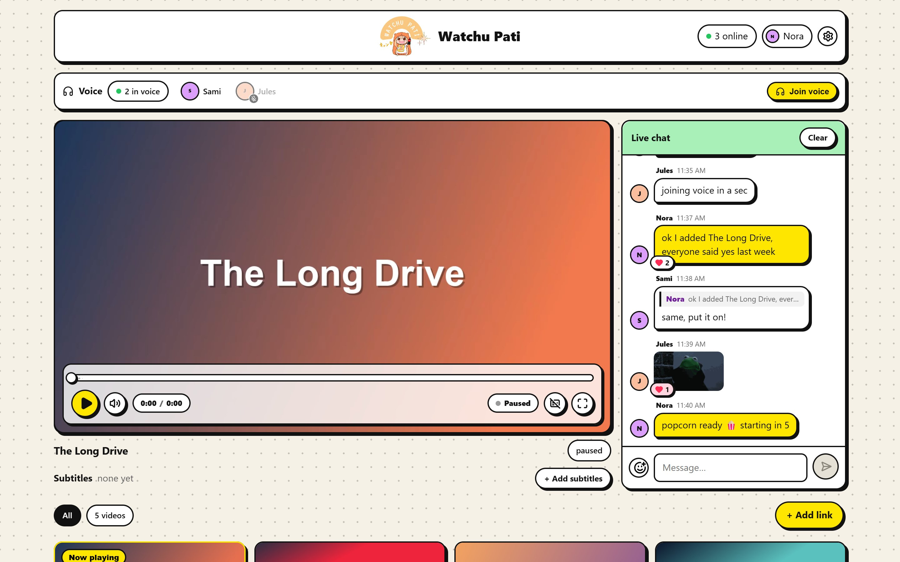
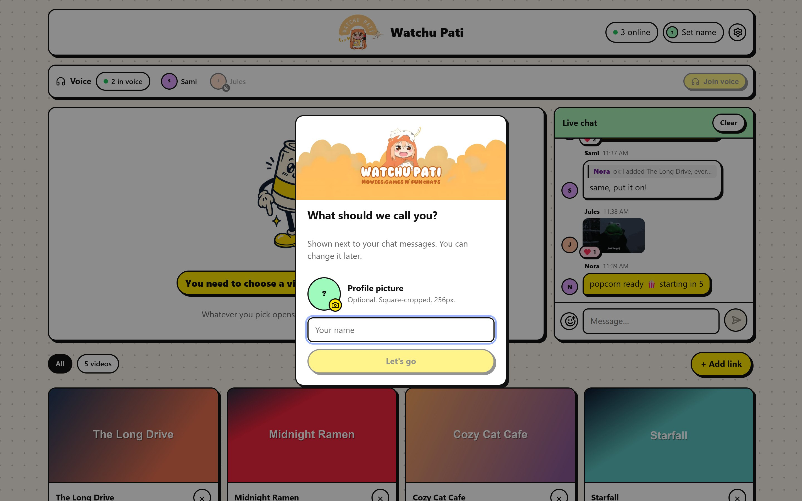
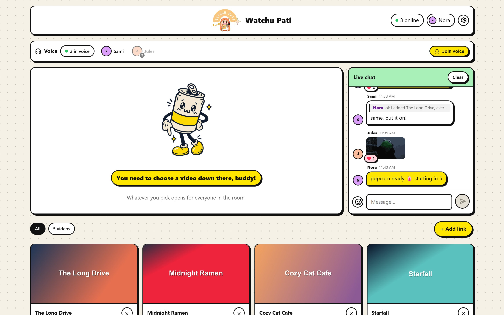
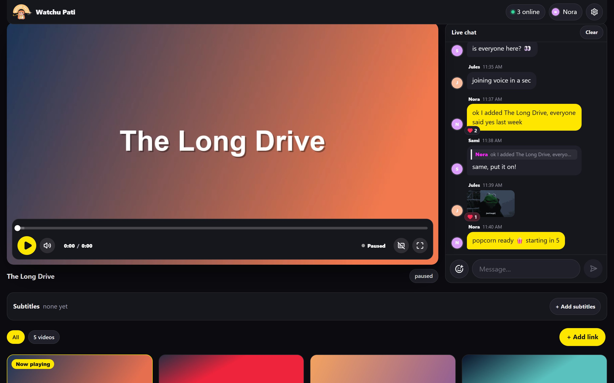
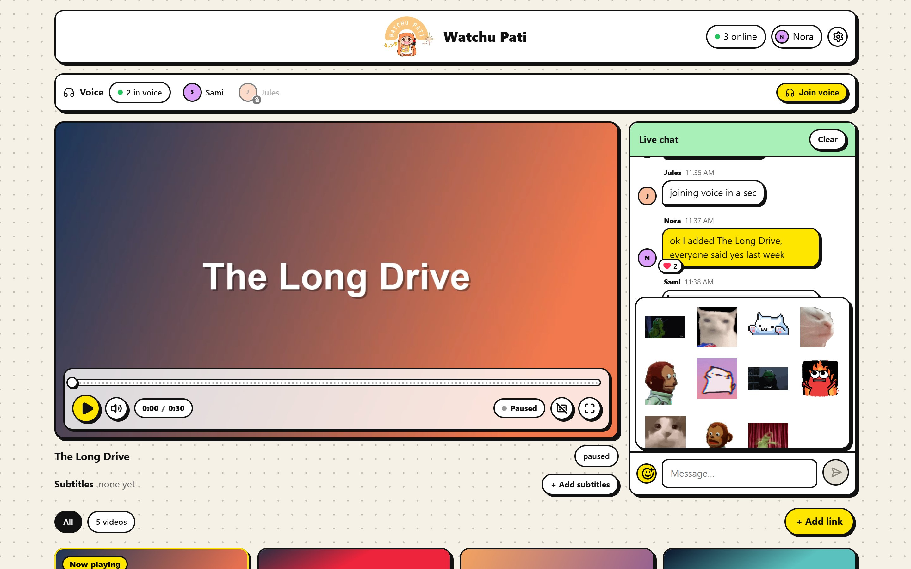
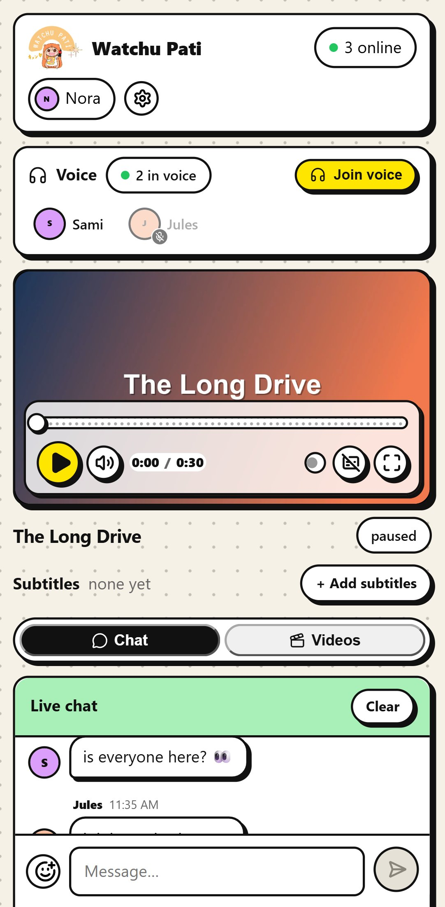
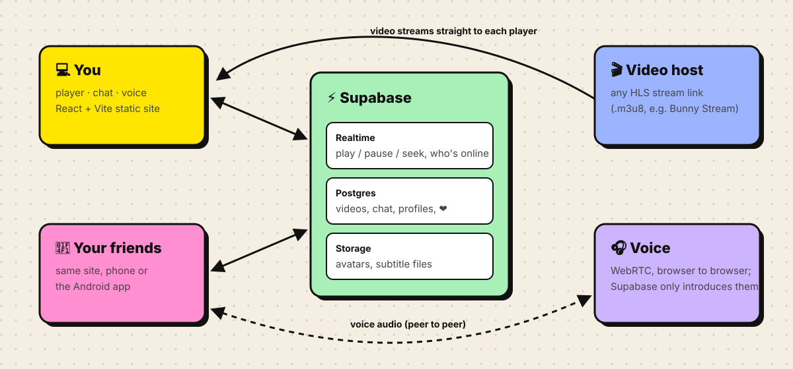
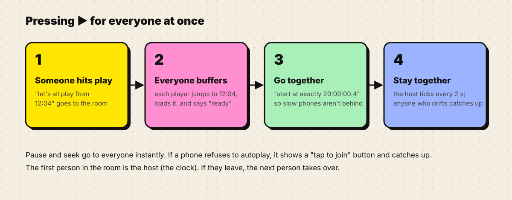

<p align="center">
  
</p>

<p align="center">
  <b>A tiny, self-hosted watch party for you and your friends.</b><br>
  Pick a video, press play, and everyone watches the same frame at the same moment, with live chat, stickers and voice.
</p>

<p align="center">
  
  
  
  
  
</p>

<p align="center">
  
</p>

> [!NOTE]
> This is a **personal project**. There's no public instance and no downloads: you run your own copy on a free Supabase project and any static host. The steps are [below](#run-your-own).

## Contents

- [Features](#features)
- [A look around](#a-look-around)
- [How it works](#how-it-works)
- [Run your own](#run-your-own)
- [Android app (optional)](#android-app-optional)
- [Privacy](#privacy)
- [Project layout](#project-layout)

## Features

|  |  |
| --- | --- |
| ▶️ **Synced playback** | Play, pause and seek happen for everyone. A start waits until every player has buffered, so nobody is left behind. |
| 💬 **Live chat** | Replies, ❤️ reactions, a typing indicator, and a shared "Clear" for a fresh start. |
| 🐱 **Stickers** | A GIF sticker pack built into the chat. Drop a GIF in `src/assets/stickers/` and it appears in the picker. |
| 🎧 **Voice chat** | One click to join, mute, and see who's speaking. Audio goes directly between browsers. |
| 🎬 **Shared library** | Add any HLS stream link (`.m3u8`). Thumbnails are picked up automatically for Bunny Stream links. |
| 🔤 **Subtitles** | Add `.vtt` or `.srt` files by link or upload, per video, for everyone. |
| 🙋 **Profiles** | A name and an optional picture. No accounts and no passwords. |
| 🌙 **Theater layout** | A dark layout with the player pinned and the chat filling the screen. Chat can also float over fullscreen video. |
| 📱 **Phone friendly** | On phones, chat and the library become tabs. There's an optional Android app too. |

## A look around

<table>
  <tr>
    <td width="50%"></td>
    <td width="50%"></td>
  </tr>
  <tr>
    <td><b>Say hi.</b> Pick a name and, if you like, a picture.</td>
    <td><b>The room.</b> Who's online and who's in voice, plus the shared library.</td>
  </tr>
  <tr>
    <td></td>
    <td></td>
  </tr>
  <tr>
    <td><b>Theater layout.</b> Switch to it under ⚙️ Settings.</td>
    <td><b>Stickers.</b> Because some moments need a cat.</td>
  </tr>
</table>

<p align="center">
  
  <br><sub>On a phone</sub>
</p>

<sub>Screenshots use made-up people and demo videos.</sub>

## How it works

<p align="center">
  
</p>

There is **no server of your own**. The site is a static React app. [Supabase](https://supabase.com) does the rest:

- **Realtime** broadcasts carry play, pause and seek, and presence tracks who's online.
- **Postgres** stores the video list, chat, profiles and reactions. The browsers subscribe to changes, so updates appear live.
- **Storage** holds profile pictures and uploaded subtitle files.

Video streams from wherever it's hosted, straight into each player. Voice uses WebRTC between browsers, and Supabase only helps them find each other.

<p align="center">
  
</p>

## Run your own

You'll need [Node.js](https://nodejs.org) 20+, a free [Supabase](https://supabase.com) project and somewhere to host videos as HLS (for example [Bunny Stream](https://bunny.net/stream/)).

**1. Set up the database.** In your Supabase project, open the **SQL editor** and run each file in [`supabase/migrations/`](supabase/migrations) in filename order. This creates the tables, row-level-security policies, realtime publications and the `avatars` and `subtitles` storage buckets.

**2. Configure.**

```sh
cp .env.example .env
```

| Variable | What to put |
| --- | --- |
| `VITE_SUPABASE_URL` | Project Settings → API → Project URL |
| `VITE_SUPABASE_ANON_KEY` | Project Settings → API → `anon` public key |
| `VITE_ROOM` | Any long random string. Everyone on your site shares this room. |
| `SITE_URL` | *(optional)* Your site's address, used for link previews |

**3. Run it.**

```sh
npm install
npm run dev       # http://localhost:5173
```

**4. Deploy.** `npm run build` produces a static site in `dist/`. Host it anywhere static, such as Vercel, Netlify or Cloudflare Pages, and set the same environment variables there. On Vercel, link previews pick up your domain automatically.

**5. Add videos.** Click **+ Add link** and paste an HLS playlist URL (`…/playlist.m3u8`). Subtitles can be added per video once it's playing.

## Android app (optional)

The `android/` folder is a [Capacitor](https://capacitorjs.com) shell. Set `CAP_SERVER_URL` in `.env` to your deployed site, and the app becomes a thin wrapper that loads it, so every deploy is live in the app straight away. Leave it empty and the app runs the bundled build instead.

```sh
npm run android:apk       # debug APK (needs Android Studio / JDK 17+)
npm run android:release   # signed release APK, copied to public/watchu-pati.apk
```

Release signing reads `android/keystore.properties` (`storeFile`, `storePassword`, `keyAlias`, `keyPassword`) and your keystore. Both are gitignored, so keep backups: you need the same key to ship updates.

## Privacy

Watchu Pati is made for a small group of friends, not the open internet.

- There are **no accounts**. Anyone who can open your site can join the room, chat and add videos. **Treat your site's URL as the password** and share it only with people you'd invite to your couch.
- The Supabase anon key is in the site's JavaScript. That's normal for Supabase, and the row-level-security policies in the migrations decide what it can do.
- Chat, names and pictures live in **your** Supabase project. Nothing goes anywhere else.

## Project layout

```
src/
  App.tsx            layout: top bar, voice bar, player, chat, library
  hooks/useSync.ts   synced playback (handshake, host heartbeat, drift fixes)
  hooks/useChat.ts   messages, replies, reactions, typing
  hooks/useVoice.ts  WebRTC voice with Supabase signalling
  components/        Player, Chat, Library, Subtitles, Settings, ...
  lib/               Supabase client, profiles, videos, subtitles, stickers
supabase/migrations/ database schema and policies
android/             Capacitor Android shell
```

Checks: `npm run lint` and `npm run build`.
